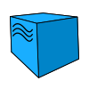

## Profile

**Senior SDET / QA Automation Architect** with a systems and low-level engineering background. Focused on building scalable, high-performance test automation engines and CI/CD-driven quality systems for distributed backend architectures.

Systems thinker working across application, network, and hardware layers. Passionate about Clean Code, SOLID principles, concurrency, reliability engineering, and hardware–software interaction.

### Key Highlights & Engineering Experience:
* **High-Performance Automation Architecture:** Designed and built a thread-safe Java test automation engine from scratch (SOLID, Clean Code) with hardware-bound linear scalability, achieving a **5x speedup** in regression suite execution.
* **FinTech & Distributed Systems:** Deep hands-on experience testing core banking systems (ABS CFT), microservices, event-driven architectures (**Apache Kafka**), and optimizing database connection pools (**PostgreSQL**, **HikariCP**).
* **AI-Driven Engineering & Tooling:** Built custom internal QA tools and browser extensions, including programmatic **LLM API integrations (OpenRouter)** via a custom backend. Actively leveraging autonomous AI coding agents (**OpenCode**) in daily workflows.
* **Continuous Growth:** Finalizing the advanced **Java Developer. Professional** program at **OTUS** (capstone project: a high-load FinTech money transfer backend paired with a custom multithreaded test automation framework).

### Languages and tools:

  
  
  
  
  
  
  
  
  
  
  
  
  
  
<!-- 
 -->

<!-- 
 -->
  
  
  
  

<!-- ### Activity on GitHub: -->
<!-- 
 -->
<!--   -->
<!-- 
 -->

<!--
### Contacts:

**AleksandrButakov/AleksandrButakov** is a ✨ _special_ ✨ repository because its `README.md` (this file) appears on your GitHub profile.

Here are some ideas to get you started:
- 🔭 I’m currently working on ...
- 🌱 I’m currently learning ...
- 👯 I’m looking to collaborate on ...
- 🤔 I’m looking for help with ...
- 💬 Ask me about ...
- 📫 How to reach me: ...
- 😄 Pronouns: ...
- ⚡ Fun fact: ...
-->
